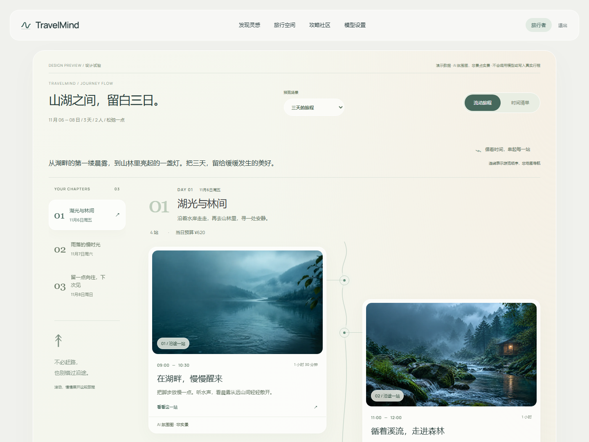

# TravelMind AI · 智能旅行规划助手

**把零散的旅行想法，整理成可以带着出发的行程。**

中文项目说明 · 在线体验 · 全栈 AI 应用 · 多角色旅行规划

TravelMind AI 是一个全栈 AI 旅行规划项目：从目的地、日期、预算和偏好出发，结合景点、天气、住宿与交通信息，生成按天组织的行程，并提供 AI 调整、预算查看、地图信息、攻略社区与 PDF 导出。

[在线体验](https://travel.rainflow.foo) · [快速开始](#本地运行) · [架构说明](docs/architecture.md) · [文档导航](docs/README.md)


> 新版首页与旅行空间已上线。下方行程流截图使用演示数据，实际行程以账户内记录为准。

## 在线体验 · 5 次行程生成

体验地址：**https://travel.rainflow.foo**

| 项目 | 内容 |
| --- | --- |
| 登录邮箱 | `demo@travelmind.example` |
| 登录密码 | `TravelMind-Demo-2026!` |
| 初始额度 | **总计 5 次**，所有访客共用一个账户和额度池 |
| 使用方式 | 登录 → 新建行程 → 填写出发地、目的地、未来日期、预算和人数 → 生成行程 |
| 查看余额 | 登录后调用 `GET /api/v1/me`，查看 `generation_quota.remaining` |
| 额度用尽 | 不能提交新的生成任务，仍可查看已有行程 |

> **这不是每位访客 5 次，也不会每天自动重置。** 首次生成、重新生成、AI 调整及手动失败重试共用这 5 次额度。提交有效任务时预占 1 次；任务最终失败会自动退回，同一任务只退一次。日期不符合生成条件时直接拒绝，不扣次数。主动取消仍计次；同一幂等请求不重复扣减，任务内部自动重试不额外扣减。额度由数据库原子计数，删除行程、重新登录、重启或重复执行账户初始化均不会恢复。
>
> **公开账户内的数据对其他访客可见，也可能被其他访客修改或删除。** 请只使用虚构需求，不要输入姓名、电话、证件、精确住址、私人链接或自己的 API Key。体验账户没有管理员权限，不可修改模型配置、绑定小红书或调用独立模型/搜索/生图调试接口；需求采集使用表单模式。
>
> 该密码只用于受限公开体验账户，不是管理员或第三方服务密钥。共享余额可能已被用完，请以在线账户的实时余额为准。生成内容仅供规划参考，票价、营业时间、交通班次与天气请在出行前以官方信息核验；本项目不提供订票、支付或实时库存保证。

## 三步开始体验

1. 打开上方体验地址，使用表格中的公开账户登录。
2. 进入「新建行程」，填写出发地、目的地、未来日期、人数和预算。
3. 点击生成，等待后台任务完成，查看每日安排、参考预算及来源信息。

> 想了解实现而不消耗共享额度，可直接阅读下方技术说明，或运行本地离线演示。

## 能做什么

- **个性化行程**：根据日期、预算、人数、兴趣和出行节奏组织每日安排。
- **多角色协作**：LangGraph 编排景点、天气、酒店、交通与规划角色，保留任务进度、证据和执行记录。
- **可靠异步任务**：ARQ + Redis 执行生成任务，支持状态查询、进度流、取消和有检查点的失败恢复。
- **更清楚的信息**：区分参考预算与可核验的来源，展示住宿、交通、餐饮、景点和图片信息。
- **可继续调整与交付**：支持行程调整、手动编辑、攻略社区和 PDF 导出；公开账户的 AI 调整也会占用额度。
- **可替换服务接入**：支持兼容模型服务、搜索、地图和可选旅行 MCP，按环境及账户配置启用。

### 行程界面预览

下图为开发预览中的合成示例，使用演示数据和 AI 氛围图，**不是真实行程或实时景点照片**；线上数据、余额及页面以实际部署为准。



## 技术栈与目录

| 层次 | 技术 / 目录 |
| --- | --- |
| 网页前端 | Vue 3、TypeScript、Vite、Pinia · `apps/web` |
| 接口服务 | FastAPI、Pydantic、SQLAlchemy、Alembic · `apps/api` |
| 工作流 | LangGraph / LangChain；标准单模型回退；离线 stub |
| 异步执行 | ARQ、Redis · `apps/worker` |
| 数据持久化 | PostgreSQL；本地离线开发可使用 SQLite |
| 搜索桥接 | HTTP MCP / GrokSearch · `apps/groksearch-bridge` |
| 共享代码 | 前后端契约、UI 样式、配置 · `packages/*` |
| 部署 | Docker Compose、nginx、VPS 运维工具 · `infra` |

```text
用户填写需求
    → Vue Web → FastAPI → PostgreSQL（账户 / 行程 / 任务 / 额度）
                        → Redis / ARQ Worker
                            → LangGraph 研究与规划工作流
                            → 按配置调用模型、搜索、地图及旅行 MCP
                        ← 行程结果、进度、证据、图片与导出
```

## 本地运行

需要 Node.js 20+、Python 3.11+ 和 `uv`。以下是 **stub 离线演示**，不调用付费模型，也不要求 Redis 或 PostgreSQL；不要把它当作真实 AI 生成效果。

```powershell
git clone https://github.com/TSk615/travlemind.git
cd travlemind
npm ci
uv sync --frozen --project apps/api

# 终端 1：API（PowerShell）
$env:TRAVELMIND_AGENT_PROVIDER="stub"
$env:TRAVELMIND_QUEUE_MODE="inline"
uv run --project apps/api uvicorn travelmind_api.main:app --host 127.0.0.1 --port 8000

# 终端 2：Web
$env:VITE_API_BASE_URL="http://127.0.0.1:8000"
npm run dev:web
```

打开 `http://127.0.0.1:5173`，注册本地账户。Windows 也可使用 `start.cmd` / `stop.cmd`。

- 真实 AI 模式：配置自己的模型服务，按需启用 LangGraph、搜索、地图与旅行 MCP。
- 环境变量模板：[infra/.env.example](infra/.env.example)。不要提交 `.env`、数据库、私钥或真实 API Key。
- 完整启动方式：[本地开发与 Compose](docs/local-development.md)。
- 部署与检查：[VPS 运维](docs/vps-deployment.md)、[公开体验账户管理](docs/public-demo.md)。

## 测试

```powershell
npm run test:web:unit
npm run build:web
uv run --project apps/api pytest apps/api/tests -q
```

额度专项测试覆盖 5 次上限、并发防超扣、幂等去重、事务回滚、登录 / 删除行程不重置、普通账户不受限和公开账户权限隔离。PostgreSQL 专项测试需额外配置 `TRAVELMIND_TEST_POSTGRES_URL`；未配置时部分集成检查会跳过。端到端及容器检查由 [GitHub Actions](.github/workflows/ci.yml) 定义，测试通过不代表所有外部服务永久可用。

## 文档与项目状态

- [文档导航](docs/README.md)：先看架构、启动、接口与部署，再按需阅读历史记录。
- [当前架构](docs/architecture.md) · [API 概览](docs/api-overview.md) · [开发说明](docs/development.md)
- [LangGraph 上线 / 回退手册](docs/langgraph-rollout-runbook.md)
- [LangGraph 迁移验证](docs/langgraph-migration-verification-2026-09-20.md)

这是持续迭代的个人项目，不是票务交易平台。自适应行程微调实验默认关闭，并且不在生产环境启用；相关实验记录不代表已经上线的能力。临时测试产物、原始供应商响应、数据库、个人凭据和本地调试截图不作为发布内容上传。

- [生成链路稳定性修复与真实验收（2026-11-03）](docs/generation-reliability-acceptance-2026-11-03.md)
- [失败自动退次与中文提示验收（2026-11-03）](docs/failure-refund-acceptance-2026-11-03.md)

### 搜索失败兜底

Grok 搜索超时、报错或缺少可用来源时，bridge 会自动改用 Exa，保留标题、链接和正文摘要，并继续合并已有来源。需要在服务端配置 `EXA_API_KEY`；Key 不下发到网页。搜索和规划是两条独立链路，搜索兜底不代表行程一定生成成功。详细配置、超时和失败处理见 [GrokSearch 与 Exa 配置说明](docs/groksearch-local-setup.md)。
