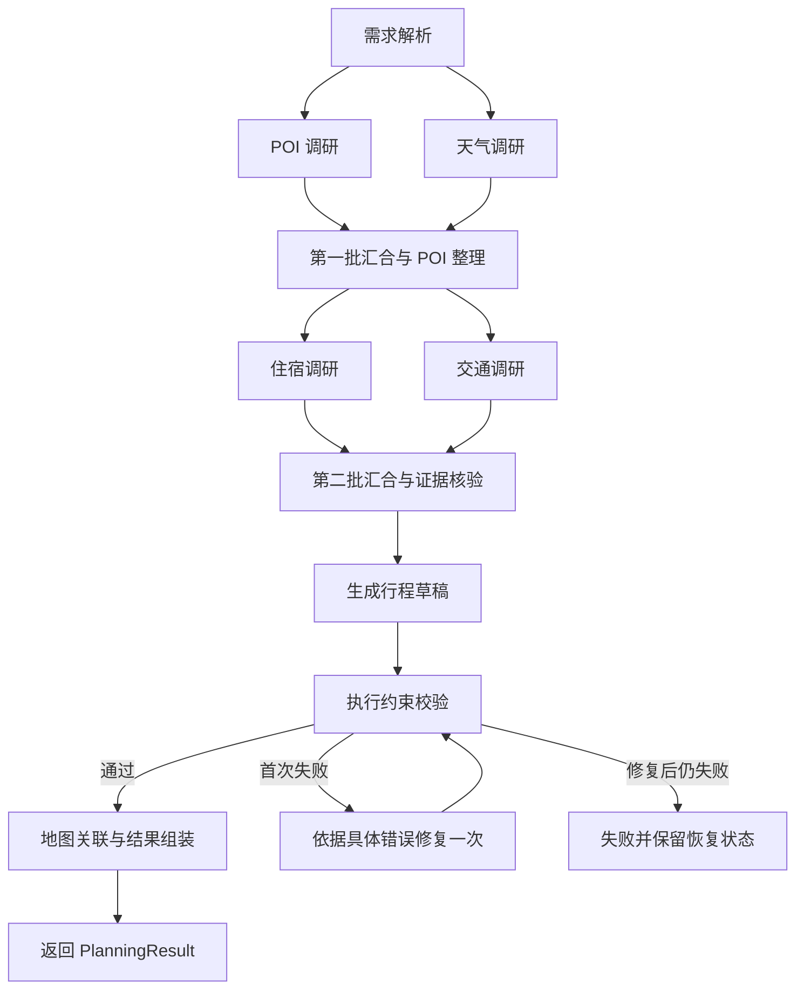

# TravelMind AI：LangChain / LangGraph 迁移评估与计划

评估日期：2026-09-20。实施状态：`codex/langchain-migration` 已完成 P0–P5 代码迁移与本地
质量门禁；PostgreSQL、真实模型端点及生产灰度仍须按
[`langgraph-migration-verification-2026-09-20.md`](./langgraph-migration-verification-2026-09-20.md)
完成外部验收。下文的“当前项目”和基线测试描述保留迁移前快照语义，用于解释方案来源。

本文将“更改 LangChain 框架”理解为：把当前 HelloAgents 与自定义 AI 编排逐步迁移到 LangChain 生态。分析依据为当前工作区代码、一次相关测试运行和当日官方文档；当前未提交的 POI 营业日校验等变更也包含在评估范围内。

**建议迁移，以 LangGraph 负责工作流，按需使用 LangChain 模型与结构化输出组件。先保留现有模型网关及旅游业务规则，通过新编排器逐步切换。**

如果项目继续发展为长期维护的多步骤旅行规划产品，这一方向更合适。如果近期只是完成演示，或者只想解决某个模型超时，先整理现有实现更划算。更换框架本身不会提高搜索资料真实性，也不保证降低耗时或模型费用。

## 1. 当前项目实际情况

| 发现 | 代码依据 | 对迁移的影响 |
| --- | --- | --- |
| 已定义 `AgentOrchestrator`，统一生成、微调、来源摘要、导出草稿 | [base.py](E:/travel/apps/api/src/travelmind_api/agents/base.py:264)、[factory.py](E:/travel/apps/api/src/travelmind_api/agents/factory.py:17) | 可以增加实现，保留调用方主要契约 |
| HelloAgents 编排文件共 5,920 行，混合 Schema、执行顺序、工具准备、证据校验、格式转换和恢复逻辑 | [helloagents.py](E:/travel/apps/api/src/travelmind_api/agents/helloagents.py:744) | 主要工作是拆分职责，不能仅替换 import |
| 当前生成主流程有六个模型角色，分两批执行专家角色 | [helloagents.py](E:/travel/apps/api/src/travelmind_api/agents/helloagents.py:953) | 适合明确节点、分支和汇合的工作流 |
| 单个角色使用 `SimpleAgent`，显式设置 `enable_tool_calling=False`，工具资料由程序预先准备 | [helloagents.py](E:/travel/apps/api/src/travelmind_api/agents/helloagents.py:1722) | 首期用普通模型调用节点即可，无需把每个角色改成自主 Agent |
| 已有线程池并行、同一 Grok 端点限流串行化、手写角色 checkpoint | [helloagents.py](E:/travel/apps/api/src/travelmind_api/agents/helloagents.py:819)、[批次执行](E:/travel/apps/api/src/travelmind_api/agents/helloagents.py:1644) | LangGraph 能接管部分通用编排，但现有能力需逐项保持 |
| 角色结果先写入实例内存；生成捕获异常后，handler 才将 checkpoint 写入 Job | [handlers.py](E:/travel/apps/api/src/travelmind_api/jobs/handlers.py:219)、[生成处理](E:/travel/apps/api/src/travelmind_api/jobs/handlers.py:447) | 进程突然退出时，不能依赖异常处理保存当轮最新角色结果；持久化节点结果是明确收益 |
| 自定义模型客户端共 934 行，处理多协议、Responses/Chat、流式响应、引用和重试 | [client.py](E:/travel/apps/api/src/travelmind_api/services/llm/client.py:26)、[helloagents_llm.py](E:/travel/apps/api/src/travelmind_api/agents/helloagents_llm.py:22) | 直接全面替换为 SDK 的兼容风险较高，先包适配层 |
| ARQ 已处理队列、心跳、重试和失活任务恢复 | [worker.py](E:/travel/apps/worker/src/travelmind_worker/worker.py:30) | 保留 ARQ；它管理任务投递，LangGraph 管理一次任务内部的执行状态 |
| 后端 `trip.refine` 禁用 HelloAgents，详情页微调则走前端编排和后端模型代理 | [handlers.py](E:/travel/apps/api/src/travelmind_api/jobs/handlers.py:530)、[TripDetailView.vue](E:/travel/apps/web/src/views/TripDetailView.vue:2114) | 只修改工厂函数无法完成产品迁移 |
| provider 在共享类型、前端归一化、设置界面和后端校验中都有约束 | [shared-types](E:/travel/packages/shared-types/src/index.ts:4)、[llmSettings.ts](E:/travel/apps/web/src/stores/llmSettings.ts:60)、[provider.py](E:/travel/apps/api/src/travelmind_api/agents/provider.py:3) | 新 provider 需要前后端同步，避免被归一化成 `standard` |

还有两项边界值得保留：`HelloAgentsOrchestrator` 的来源摘要和导出草稿主要委托给现有基类；图片补全是独立的 `trip.image_enrich` 后续任务。这些功能不必为了框架迁移重新实现。

**许可背景。** 当前锁定的 `hello-agents==1.0.0` 安装元数据标注 `CC-BY-NC-SA-4.0`，项目 README 已明确把它限制为 PoC 集成。上游当前许可证与此一致；LangGraph 和 LangChain 主仓库采用 MIT。若目标包含商业发布，替换这一依赖有现实意义，但仅改类名或删除依赖不能证明项目已完成许可清理，还需核对复用代码来源和分发包。来源：[HelloAgents LICENSE](https://raw.githubusercontent.com/jjyaoao/HelloAgents/main/LICENSE)、[LangGraph LICENSE](https://raw.githubusercontent.com/langchain-ai/langgraph/main/LICENSE)、[LangChain LICENSE](https://raw.githubusercontent.com/langchain-ai/langchain/master/LICENSE)。

## 2. 为什么优先选择 LangGraph

官方文档将 LangGraph 定位为可混合确定性代码与模型步骤的底层编排运行时，并明确允许独立于 LangChain 使用；LangChain 提供模型、工具和 Agent 循环等组件。项目当前的执行顺序主要由代码预先确定，适合这种分工。来源：[LangGraph 概览](https://docs.langchain.com/oss/python/langgraph/overview)、[工作流与 Agent](https://docs.langchain.com/oss/python/langgraph/workflows-agents)。

| 选项 | 收益 | 代价 | 本项目建议 |
| --- | --- | --- | --- |
| 保留现状，拆分 Python 代码 | 改动小，快速改善维护性 | 继续维护恢复、并发和状态管理 | 短期演示或集中修复单个问题时可用 |
| 只把角色换成 LangChain 调用 | 模型调用接口更统一 | 主流程、恢复和多入口问题仍存在 | 可作为过渡步骤，独立收益有限 |
| LangGraph 编排 + 按需 LangChain 组件 | 节点状态、分支、恢复、有限修复流程更清晰 | 增加状态存储、版本管理和学习成本 | 推荐作为长期方向 |
| 一次重写为自主多 Agent 系统 | 工具选择更自由 | 行为变化大，调用次数与约束更难控制 | 当前流程缺少足够需求支撑 |

LangGraph 可以帮助保存成功节点的输出，并在同一并行批次部分失败时恢复成功节点的结果。实际落地需要配置持久化 checkpointer，不能仅使用内存实现就宣称支持进程重启恢复。来源：[Checkpointers](https://docs.langchain.com/oss/python/langgraph/checkpointers)。

## 3. 目标结构

```text
Vue 页面
  → FastAPI：鉴权、校验、创建 Job
  → ARQ / inline：调度执行
  → AgentOrchestrator
      → standard：现有轻量实现
      → helloagents：迁移期兼容实现
      → langgraph：新增多步骤实现
          → 工作流节点与 checkpoint
          → RoleInvoker：现有客户端适配 / 后续 LangChain 模型适配
          → 搜索、地图、证据、预算等独立业务服务
  → handler：事务保存行程、创建图片补全任务、更新 Job
```

第一版保持当前两批专家的依赖顺序，先证明行为等价，再单独评估能否让天气与后续步骤更充分并行。



汇合节点必须显式等待该批所需分支全部完成，避免任一分支先完成就提前触发 planner。并行节点写不同的结果字段；共享引用与日志按稳定 ID 合并，防止恢复时重复追加。图中的检查、合并等节点仍然是普通 Python 逻辑。状态、节点、边及合并规则可参考 [Graph API](https://docs.langchain.com/oss/python/langgraph/graph-api)。

建议的新增模块，名称可在实施时微调：

| 位置（相对 `apps/api/src/travelmind_api/`） | 职责 |
| --- | --- |
| `agents/langgraph_orchestrator.py` | 实现现有协议，转换输入和结果 |
| `agents/runtime.py` | 框架无关的运行上下文、进度回调和取消检查 |
| `agents/workflows/trip_generation.py` | 定义生成图及依赖 |
| `agents/workflows/trip_refinement.py` | 定义微调图及受影响节点 |
| `agents/workflows/state.py` | 持久化状态、版本、恢复指纹 |
| `agents/workflows/nodes/` | 角色调用、证据核验、校验修复、结果组装 |
| `services/planning/role_models.py` | 从 HelloAgents 文件提取业务 Schema |
| `services/planning/payloads.py` | 提取角色输入整理和上下文压缩 |
| `services/planning/result_builder.py` | 提取结果转换、地图关联等规则 |
| `services/llm/role_invoker.py` | 统一返回内容、引用、用量、耗时、请求标识 |
| `services/workflow_store.py` | checkpointer 生命周期、执行记录和 Job 关联 |
| `prompts/roles/trip.py` | 框架无关的角色提示词与版本 |

## 4. 必须明确的设计约束

**模型接入分两步。** 第一阶段节点通过 `RoleInvoker` 调用现有 `OpenAICompatibleClient`，保留角色模型覆盖、Grok 流式行为、搜索引用及各协议兼容。第二阶段只对通过契约测试的端点接入 LangChain 模型组件；第三方网关不能仅凭模型名称就假定支持 JSON Schema 或工具调用。缺少用量信息时明确记录未知，不把它当成零成本。

**结构化输出不代替业务核验。** 优先复用 Pydantic Schema 与解析逻辑。通过能力验证的模型可增加原生结构化输出；其他模型保留 JSON 解析与有限纠错。酒店实体、日期天气、交通班次、营业日、预算和跨日时间冲突继续由确定性服务检查。官方也区分 provider 原生结构化输出与工具策略，能力取决于具体模型及端点。来源：[结构化输出](https://docs.langchain.com/oss/python/langchain/structured-output)。

**现有工具网关继续复用。** 首期使用 `ConfiguredSearchGateway`、地图服务和证据服务；用节点或薄工具封装调用即可。当前官方 `langchain.mcp` 接口仍标为 beta，没必要同时改变已经能运行的 MCP 连接层。后续增加自主工具选择时再进行单独验证。来源：[LangChain MCP](https://docs.langchain.com/oss/python/langchain/mcp)。

**状态与凭据分开。** 持久化状态保存脱敏的行程输入、brief、专家结果、证据引用、草稿、校验错误、修复次数、版本和运行标识。`PlanningRequest.search_service` 可能包含 API key，不能把整个对象直接写入 checkpoint。模型凭据、客户端、回调、数据库 Session 在执行时注入，并按用户隔离。

**恢复采用稳定执行 ID。** 新增框架无关的执行记录，例如 `WorkflowRun`，保存 `owner_user_id`、`trip_id`、原始 Job ID、当前 Job ID、provider、graph/schema 版本及输入指纹。生成时分配独立 `run_id`，LangGraph 的 `thread_id` 使用该值；失败重试创建新 Job 时继续关联原执行，用户主动重新生成则创建新执行。不能仅用 `trip_id`，否则多次生成及并发微调会互相覆盖。权限由应用执行记录校验，不能把知道 `thread_id` 当成访问权限。

**恢复必须校验依赖是否有效。** 指纹覆盖规范化需求、角色 prompt 版本、非敏感模型配置标识和上游结果版本；证据具有核验时间与刷新策略。日期、模型、提示词或上游证据发生变化时，使对应节点及下游失效。旧 HelloAgents checkpoint 继续交给旧实现，首期不转换为 LangGraph checkpoint。完成迁移前应处理完旧执行或明确重新生成，保留历史行程和 trace 的可读性。

**持久化与业务事务有清晰边界。** 本地采用独立 SQLite checkpoint 存储，测试可使用内存实现；多 worker 部署采用 PostgreSQL checkpointer。先以同步持久化保障阶段边界，再测量开销。检查点存储与行程写入不是一个自动原子事务：最终行程保存须以 `run_id` 做幂等控制，同时检查行程版本，防止旧任务覆盖较新的手动编辑。图片补全任务使用稳定幂等键，重复投递不得创建重复任务。缩短当前包裹完整模型执行的数据库 Session/事务，凭据解析、模型运行和最终提交分阶段处理。

**重试和取消统一预算。** 当前客户端、HelloAgents LLM 适配层和 ARQ 都包含重试；迁移时不能再直接叠加一层默认节点重试。约定 HTTP 层仅处理短暂网络错误，图层处理明确可恢复的节点失败，ARQ 负责任务恢复；每个角色配置总截止时间和总请求次数。一次草稿最多进行一次业务修复，计数随 checkpoint 保存。保留按端点与凭据身份控制的并发限制，多 worker 时需要共享限流。取消在节点边界、发请求前及最终提交前检查，停止后续节点和结果提交；已有同步 HTTP 请求能否立即中断取决于传输层，不能承诺瞬时终止。

**结果提交必须幂等。** LangGraph 恢复会重新进入未完成节点，不能保证外部模型请求或其他副作用恰好一次。因此首次图只返回 `PlanningResult`，行程持久化、图片任务创建和完成状态更新由现有业务层负责，并测试各提交边界发生崩溃的情况。来源：[节点重新执行与幂等](https://docs.langchain.com/oss/python/langgraph/graph-api)。

**可观测性沿用现有产品契约。** 图事件映射到现有 `stage`、`progress_percent` 和 `AgentTrace`。并行进度按已完成节点加权计算，避免回退；记录角色耗时、重试、缓存复用和已知用量。LangSmith 可后续作为可选工具，首期不增加云端运行依赖。

## 5. 分阶段执行

工作量按一名熟悉本项目的工程师、保持现有模型和提示词语义、具备可用测试网关估算。以下为规划区间，尚未通过迁移原型校准。

| 阶段 | 工作 | 交付与退出条件 | 预计人日 |
| --- | --- | --- | --- |
| P0：建立基线 | 确定当前未提交业务变更的基线；整理两项失败断言；固定评估样本、故障样本、返回结构 | 区分既有行为与迁移回归，关键基线测试通过 | 1–2 |
| P1：抽取边界与小验证 | 提取 Schema、prompt、RoleInvoker 和运行上下文；用 brief 节点验证图执行及序列化 | 旧实现行为保持；新路径调用现有模型客户端，不导入 HelloAgents 运行类 | 2–3 |
| P2：生成图 | 新增 `LangGraphOrchestrator`，迁移六角色、两批汇合、证据检查、一次修复及结果组装；接入 provider 和生成页面分流 | 固定模拟输入下与旧路径的业务结果一致，允许 ID、耗时、trace provider 不同 | 3–4 |
| P3：恢复与任务集成 | 落地 WorkflowRun/checkpointer、重试预算、取消、限流、版本校验与最终提交幂等；重构长事务 | 杀进程恢复、重复投递、并行部分失败、取消后不提交全部通过 | 3–4 |
| P4：统一产品入口与微调 | 统一生成入口；微调走后端图，服务端装配会话/上传攻略/社区来源；补 scope 和 day_index 约束 | 关闭页面不丢任务，上下文无遗漏，微调保留无关天数及已核验证据 | 4–6 |
| P5：灰度与清理 | 回放对比、少量真实端点评估、灰度放量、回滚演练；排空旧任务后清理旧实现及依赖 | 达到质量与可靠性门槛，再完成 HelloAgents 下线 | 2–3 |

**完整迁移约 15–22 人日，单人约 3–5 周。** 最初 3–5 人日覆盖 P0/P1，用小验证确认兼容性和状态设计。生成链路可先交付验证；P4 属于产品入口收敛，需要独立验收，不能把仅完成 P2 称为全项目迁移。

P4 的微调图建议采用：加载当前计划及会话 → 判断影响范围 → 按需更新相关专家证据 → 微调指定范围 → 完整约束校验 → 保存。纯文案修改不重跑六个角色；日期或城市变化应使天气、营业日、住宿与交通证据失效。`AgentOrchestrator.refine_trip` 当前没有会话上下文字段，应通过兼容的上下文对象或显式服务装配扩展，并为 standard 实现提供默认行为。

## 6. 具体修改范围

| 文件/模块 | 计划动作 |
| --- | --- |
| `agents/base.py`、`factory.py`、`provider.py` | 保持业务返回契约，增加新实现；把 HelloAgents 专属进度类型和私有 `_current_job_id` 注入改为中立上下文 |
| `agents/helloagents.py`、`helloagents_llm.py` | 逐步抽取自有业务逻辑与模型适配；旧文件暂作兼容，不让新实现长期依赖旧类 |
| `prompts/roles/helloagents.py` 及包导出 | 迁移到中立模块；兼容导出过渡；提示词内容变化单独记录版本 |
| `jobs/handlers.py`、`services/job_service.py`、`api/routes/jobs.py` | provider 固定到执行记录；恢复按执行版本分发，保持现有重试接口和可恢复状态展示 |
| `db/models.py`、新增 Alembic migration | 新增执行关联及幂等提交元数据，保留既有 Job 和行程数据；checkpoint 表由统一部署步骤初始化 |
| `services/llm/*` | 首期保留传输行为，补统一结果与调用预算，后续逐端点替换 |
| `services/budgeting.py`、`execution_validation.py`、各类 `*_evidence.py` | 保留并复用；从旧编排类提取其余规则，测试按业务职责归属 |
| `api/routes/llm.py` | 处理 POI 探针直接导入旧 orchestrator 和调用私有方法的耦合 |
| `services/refine_session_service.py`、`api/routes/trips.py` | 后端装配微调上下文与来源，保持所有权检查和会话追加语义 |
| `packages/shared-types/src/index.ts`、`services/auth_service.py`、设置 Schema/路由 | 同步 provider 类型、允许值及错误文案；用户设置变更不改变已在运行任务的引擎 |
| `llmSettings.ts`、`SettingsView.vue`、`LlmStatusNotice.vue`、`TripDetailView.vue`、`NewTripView.vue` | 接入新选项和统一后端任务流程；不再以 `usesHelloAgents` 判断唯一需要后端执行的引擎 |
| `browserPlanner.ts` | P4 后解除生成和微调入口依赖，再依据剩余调用决定清理 |
| API/worker 的 `pyproject.toml`、`uv.lock`，启动脚本、Docker/CI、文档 | 固定并验证兼容版本；API 与 worker 同步更新；移除 HelloAgents 启动专属开关及失效说明 |

首期直接依赖以 `langgraph` 和所选 checkpoint 包为主；显式使用 Runnable 等接口时再声明 `langchain-core`。完整 `langchain`、各 provider 集成包或 MCP extra 按实际使用增加。实施时验证 Python 版本、Pydantic、psycopg 和锁文件兼容性，不在本方案中猜测最新补丁版本。

## 7. 验收、灰度与回滚

**本次已执行的测试基线：**

```powershell
.\apps\api\.venv\Scripts\python.exe -m pytest apps/api/tests/test_llm_orchestrator.py apps/api/tests/test_planning_quality.py apps/api/tests/test_itinerary_execution_safety.py apps/api/tests/test_job_reliability.py -q --tb=short
```

结果：**142 passed，2 failed，14.03 秒**。另有两条 pytest 缓存目录写入权限警告。此结果只代表上述四个测试文件，不代表完整 API 或真实上游兼容性通过。

| 当前失败测试 | 实际差异 | P0 处理方式 |
| --- | --- | --- |
| `test_hotel_specialist_prompt_rejects_unsourced_concrete_hotel_names` | 断言预期“来源充足的备选”，现有提示词使用“来源充足的不同实体” | 核对最终业务要求，保留来源与实体约束的有效验证 |
| `test_helloagents_poi_grounding_accepts_lightweight_top_pois_shape` | POI 结果较精确字典断言多出 `booking_info`、`visit_requirements`、`caveats`、`evidence_notes` | 将已新增字段纳入契约，避免错误删除有价值的证据字段 |

这两项为迁移前当前工作区的失败；本次分析没有修改这些业务代码或测试。

上线门槛建议如下，属于拟定验收条件而非已经达到的指标：

1. 固定模拟响应下新旧结果通过同一 Pydantic 契约，预算、日期、交通和证据规则一致；不以自然语言逐字一致作为真实模型验收标准。
2. 建立至少 30 组回放案例，覆盖单城/跨城、跨夜交通、低预算、住宿偏好、POI 闭馆、未来天气、证据不足、单日微调和无可用上游。日期样本用受控时钟或相对日期，避免测试自然过期。
3. 独立验证：成功分支不因其他分支失败而重复调用；进程退出后可恢复；重复 Job 不重复提交；旧 worker 延迟返回不会覆盖新计划；取消后不再保存结果；不同用户状态与凭据不串用。
4. 模拟并验证 Responses、Chat Completions、Gemini、Claude、NewAPI/NeiAPI 以及 Grok 引用和流式异常的现有兼容行为；真实端点做受控小样本验证。
5. 质量门槛：固定案例中硬性日期、预算算术和班次证据违规为零；质量与成功率不低于基线。拟以 p95 耗时和已知调用费用不增加超过 10% 作为初始性能门槛，P0 按基线校准；当前尚无真实成本或耗时对比。
6. 运行完整 API 相关测试、前端构建及生成/微调 E2E、worker 导入与执行测试、SQLite/PostgreSQL 迁移及恢复测试。

灰度顺序为模拟回放 → 内部真实样本 → 少量新任务 → 扩大流量。先离线比较；生产请求若执行双份模型调用，应显式计入预算，比较分支不保存用户行程、不派发图片补全任务。

回滚通过 provider/灰度开关只切回新任务。运行中的任务继续使用创建时固定的引擎和版本；不能把 LangGraph checkpoint 交给 HelloAgents 解读。迁移期保留旧执行所需运行环境，待旧任务及回滚窗口结束再删除依赖。移除旧实现后，回滚依赖保留的部署版本，数据库迁移保持向后兼容。

## 8. 推荐实施起点

第一批变更聚焦 P0/P1：整理当前两项失败测试，提取业务 Schema 和角色调用接口，然后让 LangGraph 完成一个 brief 节点并可保存、读取状态。该验证通过后，再迁移六角色生成图。这样能尽早验证最关键的模型兼容性与恢复设计，并为后续完整迁移建立可比较的基线。
